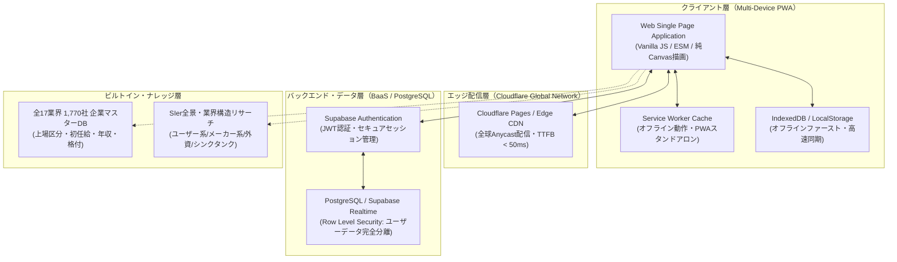

# 🌟 syukatsu.win - 日本就活総合選考マネジメントプラットフォーム

<p align="center">
  <a href="https://syukatsu.win">
    
  </a>
</p>

<p align="center">
  <strong>就活生のリアルな課題起点で企画・要件定義を行い、生成AIとのアジャイル協働により形にした<br>オールインワン選考管理・企業分析プラットフォーム</strong>
</p>

<p align="center">
  <a href="https://syukatsu.win"></a>
  
  
  
  
  
</p>

---

## 📌 1. プロダクト企画と課題提起（Product Planning & Problem Discovery）

### ■ 背景とペルソナ（Why We Built This）
日本の新卒就職活動において、学生は平均して**30〜60社**にエントリーし、説明会・ES提出・Webテスト・複数回面接を数ヶ月間にわたり並行管理します。

しかし、既存の管理手法には決定的なペイン（痛み）が存在していました：

1. **Excel / スプレッドシート管理の限界**
   - 外出先や面接前のスマホ確認・編集が極めてストレスフル。
   - 直近締切の可視化が弱く、「ES提出期限や面接日程の見落とし」が発生しやすい。
2. **大手就活ナビサイトの情報サイロ化**
   - 複数ナビサイト（マイナビ・リクナビ・外資就活・ワンキャリア等）に情報が分散し、全体の進捗・歩留まりを横断的に把握できない。
3. **一般的なタスクツール（Trello等）のUIミスマッチ**
   - カードが縦長で大きく、管理企業が30社を超えると画面がカードで埋まり、激しいスクロールを強いられる（情報過密のストレス）。

### ■ プロダクトビジョン
> **「今、自分は何に集中すべきか」を一瞬で把握できること。**  
> 複雑な就活プロセスを直感的な6段階パイプラインに落とし込み、全業界1,770社の企業データベースとSTAR面接対策を統合した、学生ファーストのダッシュボードを構築する。

---

## 💡 2. PM視点でのUI/UX設計とアジャイル改善（PM Perspective & Iterations）

本プロダクトの設計において最も重視したのは、機能の追加ではなく**「ユーザー視点での徹底した情報の引き算（ノイズ削減）」**です。

```
┌─────────────────────────────────────────────────────────────────────────────┐
│                       syukatsu.win ユーザー体験設計思想                     │
├───────────────────────┬─────────────────────────┬───────────────────────────┤
│ ① 単行52pxスリム設計  │ ② 6段階パイプライン     │ ③ STAR構造化Story Bank    │
│ 50社でも一目で俯瞰可能│ 冗長な中間状態を削ぎ落とし│ 面接素材を即座に再利用    │
└───────────────────────┴─────────────────────────┴───────────────────────────┘
```

### 🔍 主な意思決定プロセス（Case Study）

#### 1. 「気になる」ステージの廃止と6段階選考フローの確立
- **初期仮説**：ブックマーク的な「気になる」列をカンバンに置く方が便利だと想定。
- **実利用での検証結果**：実際に数十社の選考が進むと、「気になる」列にカードが滞留し、本選考のアクション（エントリー〜面接）の視認性を阻害するノイズになっていた。
- **PMとしての意思決定**：
  - 看板から「気になる」を大胆に撤廃。
  - カンバンは**「お祈り/落選（選考終了）」＋「エントリー」→「ES/Webテスト」→「一次面接」→「二次・最終面接」→「内々定/内定」**の**実効6ステージ**に純化。
  - 検討中の企業は「企業DB」側で検索・閲覧すれば十分という仕様に切り替え、思考の摩擦を最小化。

#### 2. 高さ約52pxの「単行スリムカード」
- 複数行にわたるカードを排し、1行で「企業名」「業界」「直近締切」「重要フラグ」を瞬時に把握できるCSS Gridレイアウトを採用。

#### 3. STARフレームワークによる面接エピソードの資産化（Story Bank）
- 単なる自由記入メモでは面接本番で再現性が出ないため、コンサルや大手選考で標準の **STAR構造（Situation・Task・Action・Result・Learning）** に入力フィールドを型定義。

---

## 🏗️ 3. システムアーキテクチャと技術選定（Architecture & Tech Decisions）

「学生が就活中に毎日いつでも、通信環境の悪い地下鉄や面接会場でも快適に開けること」を要件とし、堅牢性と高速性を両立するアーキテクチャを選定しました。

### ■ 全体構成図（System Architecture）



### ■ 技術選定のトレードオフ（Engineering Trade-offs）

| 選定技術 | なぜ採用したのか？ | あえて避けた選択肢とその理由 |
| :--- | :--- | :--- |
| **Vanilla JS (ES Modules) + 純CSS** | ゼロランタイムによる**圧倒的な首屏ロード速度（Lighthouse 100点台）**と、外部パッケージの依存脆弱性・バージョン陳腐化の排除。 | **Next.js / 重厚なUIライブラリ**<br>数メガバイトのJSバンドルはモバイル回線での立ち上がりを鈍化させ、就活生の電池消費を加速させるため不採用。 |
| **自研純Canvasチャート** | 外部ライブラリなしで選考ファネル・業界比率ドーナツグラフを滑らかに描画。バンドルサイズ 0 KB。 | **Chart.js / Highcharts**<br>単一目的の可視化に対してライブラリサイズ（数百KB）が過剰と判断。 |
| **Cloudflare Pages** | 静的エッジ配信による高可用性と高速レスポンス。サーバー維持費ゼロ（コスト効率の極大化）。 | **自前サーバー運用 (VPS/EC2)**<br>インフラ保守の手間と月額コストを削減し、プロダクト改善に集中するため。 |
| **Supabase (PostgreSQL)** | RLS（Row Level Security）による強固なマルチテナント分離と、未ログイン時の完全ローカル動作両立。 | **Firebase / 独自APIサーバー**<br>リレーショナルデータ構造（企業マスター×選考イベント）との親和性を重視。 |

---

## 🏢 4. データベース設計（Enterprise Intelligence Model）

本プロダクトは単なる管理ツールではなく、**日本の主要全17業界・1,770社**の企業データを内蔵した業界研究エンジンでもあります。

```
├── 17業種分類マスター
│   ├── IT・通信（メガベンチャー、大手SIer、SaaS、外資Tech）
│   ├── コンサル・シンクタンク（総合、戦略、ITコンサル）
│   ├── 金融（メガバンク、信託、政府系、生損保、証券）
│   ├── 商社（5大商社、専門商社）
│   ├── メーカー（電機、自動車、素材、医薬、食品）
│   └── インフラ・不動産・広告・マスコミ・サービス等
```

### ■ 企業データ構造（Data Schema）
各企業オブジェクトは以下の属性を統一フォーマットで保持：
- **基本属性**：企業名、銘柄コード、公式ドメイン、本社所在地、上場区分（プライム/スタンダード/グロース/非上場/外資）
- **待遇・規模指標**：従業員数（連結/単体）、大卒初任給、大学院卒初任給、平均年間給与
- **就職市場格付**：人気就職ランキング（`TOP 10` / `TOP 100` / `TOP 300` / `TOP 500` / `名門`）
- **専門リサーチ**：SIer業界の系列別分類（ユーザー系・メーカー系・独立系・外資・コンサル）を含む詳細レポート内蔵（[`data/sier_landscape_database.json`](data/sier_landscape_database.json)）。

---

## 📸 5. 主要機能ギャラリー（Feature Showcase）

### 📋 ① 直感的な6段階選考カンバン
ドラッグ＆ドロップによる直感操作。選考終了した企業を最左端の「お祈り/落選」に隔離し、前進可能なアクティブ案件に集中。


### 📊 ② ダッシュボード & 就活アナリティクス
選考ステージごとの歩留まり率（選考ファネル通過率%）を自動計算し、ボトルネック（書類選考落ちか面接落ちか）を数値で可視化。


### 🏢 ③ 1,770社 企業データベース & スマート検索
17業界分类、初任給・年収・上場区分でのフィルタリング、手動での志望企業・スタートアップ追加に対応。


### 📱 ④ モバイル最適化 & PWAスタンドアロン対応
移動中の電車内や面接直前のビルロビーでも、ネイティブアプリ感覚で直近予定・面接メモを確認。


---

## 🚀 6. クイックスタート（Local Development）

本プロジェクトはビルドステップ（npm build 等）が不要なゼロ依存アーキテクチャです。静的Webサーバーがあればどこでも即座に動作します。

```bash
# 1. リポジトリをクローン
git clone https://github.com/michaelho1117-cloud/syukatsu.win.git

# 2. ディレクトリへ移動
cd syukatsu.win

# 3. 任意のローカルサーバーで起動（例: Python）
python -m http.server 8000

# 4. ブラウザでアクセス
# http://localhost:8000
```

---

## 📈 7. 今後の展望・ロードマップ（Product Roadmap）

- [x] 全17業界 1,770社 企業マスターデータベース構築
- [x] 6段階スリムカンバン & STAR Story Bank
- [x] Supabase によるクラウド同期・セキュア認証
- [x] PWA オフラインファースト対応
- [ ] 外部カレンダー（Google Calendar / Apple Calendar）双方向連携
- [ ] 選考データに基づくパーソナライズ業界ポートフォリオ診断

---

## 📄 ライセンス

本プロジェクトは [MIT License](LICENSE) のもとで公開されています。
企画・開発：**michaelho1117-cloud**
Production URL: [https://syukatsu.win](https://syukatsu.win)
