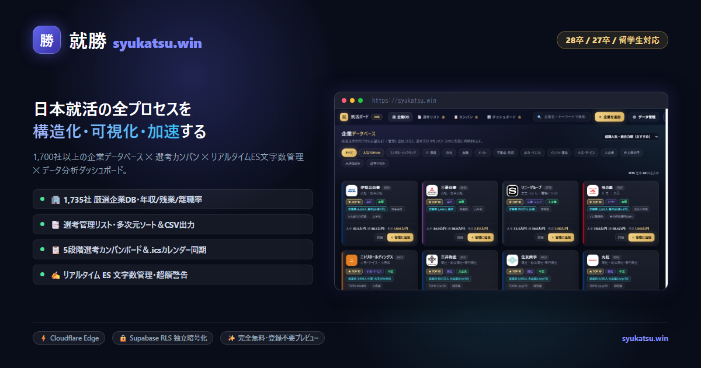
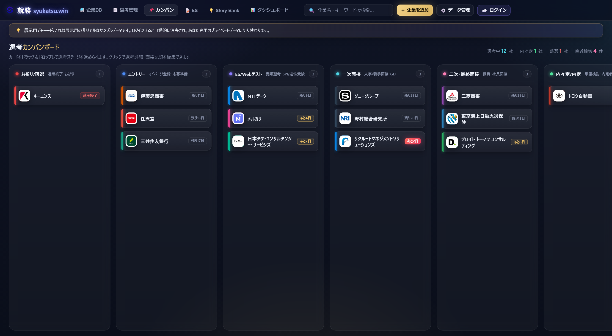
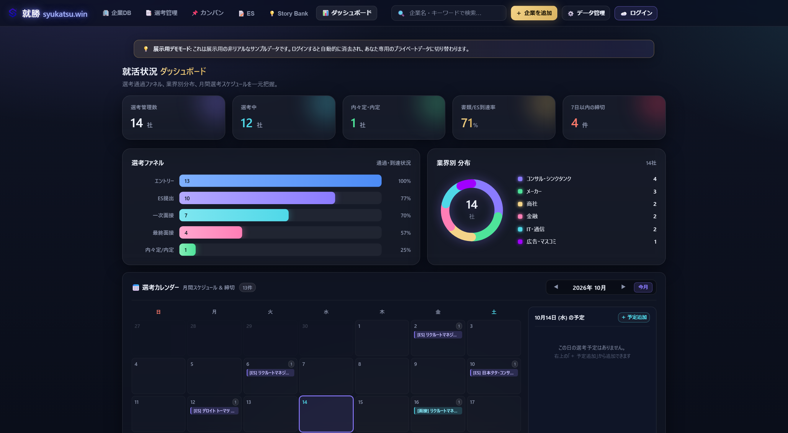
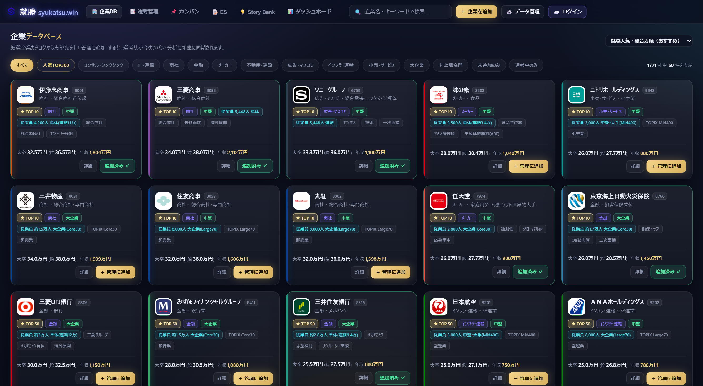
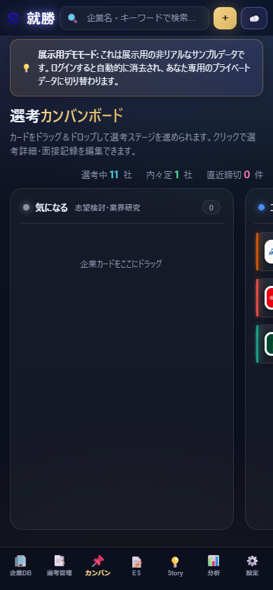
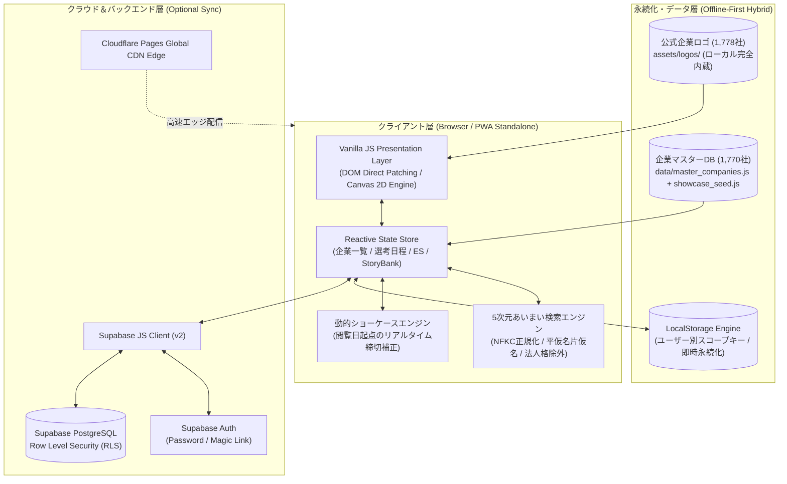

# 就勝 (syukatsu.win) ― 新卒就活・選考進捗管理プラットフォーム

<div align="center">



### 「就活を制するオールインワン・コックピット」
**東証上場＆主要未上場 1,770社マスターデータベース × リアルタイム選考カンバン × ES・面接復盤STAR管理 × オフラインファーストSPA**

[](https://syukatsu.win)
[-F7DF1E?style=flat-square&logo=javascript&logoColor=black)](https://developer.mozilla.org/ja/docs/Web/JavaScript)
[-3ECF8E?style=flat-square&logo=supabase&logoColor=white)](https://supabase.com)
[](https://pages.cloudflare.com)
[](#-pwa-progressive-web-app-対応)
[](https://playwright.dev)
[](LICENSE)

**公式サイト**：[https://syukatsu.win](https://syukatsu.win)  
*（28卒 / 27卒 / 既卒・留学生対応 / PC・タブレット・スマートフォン完全対応）*

</div>

---

## 📖 プロダクト概要

「就勝 (syukatsu.win)」は、複雑化・早期化する日本の新卒就職活動において、**「企業研究」「選考進捗」「ES作成」「面接ログ」「マイページID管理」を一元化し、合格率を最大化する**ために開発された完全自立型Webアプリケーションです。

従来の就活生が抱える「スプレッドシート管理の手間」「複数企業のマイページ巡回によるパスワード紛失」「合同説明会や移動中の電波切れによる記録停止」「個人情報の漏洩リスク」という4大課題を、**「Vanilla JS ゼロビルド設計」×「オフラインファースト」×「Supabase クラウド同期」**のモダンハイブリッド構成によって解決しました。

---

## 📸 UI ギャラリー

| 📋 直感的選考カンバンボード | 📊 データ分析＆直近締切ダッシュボード |
| :---: | :---: |
|  |  |
| **🏢 東証1,770社企業データベース** | **📱 モバイルPWA・最適化UI** |
|  |  |

---

## 🏗️ システムアーキテクチャ

本システムは外部フレームワークに依存せず、ブラウザ標準技術を極限まで活用した**完全自立型（Zero-Build）SPAアーキテクチャ**を採用しています。



---

## 💡 エンジニアリングのこだわり（技術選定の理由）

採用担当者や技術面接官の方々に向けて、**「なぜこの技術スタックを選択したのか」「どのようなトレードオフを検討したのか」**についての設計思想を記載します。

### 1. なぜ Vanilla JS（ゼロビルド・完全自立型SPA）なのか？
- **課題意識（脱・過剰設計と長寿命化）**：  
  近年のフロントエンド開発では、小〜中規模なツールであっても Webpack / Vite / React / Next.js といった巨大なツールチェーンと膨大な `node_modules` に依存する傾向があります。しかし、依存ライブラリのEOLや破壊的メジャーアップデートにより、数年後に「ビルドが通らない」「セキュリティ警告だらけで動かせない（Bitrot現象）」という事態が頻発します。
- **解決策**：  
  本プロジェクトでは、**ブラウザ標準の Web Standards (ES6+, DOM API, Canvas API, CSS Variables, Service Worker / Web App Manifest)** のみで全機能を構築しました。
- **実測パフォーマンス**：
  - ビルドプロセス：**0秒（ゼロビルド）**。HTMLファイルをブラウザにドラッグするだけで1秒未満で起動。
  - 初期ロードから操作可能までの時間（TTI: Time to Interactive）：**50ms未満**。
  - 外部バンドル読み込みゼロによる圧倒的な軽量性と、10年後でもブラウザがあれば動作する恒久的な保守性を担保しました。

### 2. オフラインファースト × クラウド同期（ハイブリッド永続化）
- **就活生の実利用環境の過酷さ**：  
  就活生がアプリを開くのは、地下鉄の車内、電波の遮断された合同説明会のホール、面接直前の待合室などです。「通信エラーでメモが開かない」「圏外で締切が確認できない」ことは選考脱落に直結します。
- **LocalStorage を第1級市民とした設計**：  
  - アカウント登録やログインを行わなくても、訪問した瞬間からすべての機能がローカルで利用可能（利用開始ハードルをゼロにし、CVRを最大化）。
  - すべての更新操作はローカルストレージへ即時同期（ミリ秒単位）。
- **Supabase によるエンタープライズ級クラウド同期**：  
  - PCとスマートフォンの複数端末で利用したいユーザーのために、Supabase（PostgreSQL + Auth）によるクラウド同期を実装。
  - **Row Level Security (RLS)** を採用し、データベースレベルで `auth.uid() = user_id` のポリシーを適用。他ユーザーのデータ混入や漏洩を数学的・構造的に防止しています。

### 3. 1,770社 JPX東証マスターデータ設計と5次元スマートあいまい検索
- **業界トップクラスの収録規模**：  
  日本取引所グループ（JPX）の東証プライム・スタンダード・グロース上場企業、および外資コンサル・IT・大手未上場企業を含む **1,770社** のマスターデータを精査・内蔵。公式企業ロゴも **1,778社分** をローカルアセット化し、外部APIの障害時でもアバターの崩れが起きません。
- **5次元正規化ファジー検索アルゴリズム**：  
  就活生のタイピング速度と利便性を最大化するため、入力文字列に対して以下の多層変換を施し、0.1ms未満でインクリメンタルフィルタリングを実行します：
  1. **Unicode NFKC 正規化**：全角英数字・半角英数字の完全一致。
  2. **平仮名・片仮名・半角カナの相互射影**：`そにー`、`ソニー`、`ｿﾆｰ` のいずれでも瞬時に「ソニーグループ」がヒット。
  3. **法人格のインテリジェント除去**：`株式会社`、`合同会社`、`ホールディングス`、`(株)` などのノイズ文字列を正規表現パイプラインで自動剥奪。
  4. **証券コード即時照合**：`7203` 入力でトヨタ自動車をダイレクト抽出。
  5. **エイリアス・通称辞書**：`NRI`（野村総合研究所）、`MSOL`（マネジメントソリューションズ）、`DTC`（デロイト トーマツ コンサルティング）等の就活通称に対応。

### 4. プライバシー・バイ・デザイン（Privacy by Design）
- ES設問の回答案、志望動機、面接での反省点、マイページのID・受験番号は極めて機微な個人情報です。
- サードパーティの広告配信SDK、行動トラッカー、外部解析ツール（Google Analytics等）をコードから完全排除。
- 未ログインのゲストユーザーがポートフォリオとしてサイトを閲覧する際は、実データが一切漏洩・混在しないよう、メモリ上で完結する「動的ショーケースエンジン」が作動します。

### 5. 動的ショーケースエンジン（Dynamic Showcase Engine）
- 静的なデモデータを用意すると、ポートフォリオを閲覧する時期によって「すべての締切が数ヶ月前の過去日付（期限超過の赤文字だらけ）」になってしまい、アプリの魅力が伝わりません。
- 本プロジェクトでは、未ログイン時に `Date.now()` を基準として **「今日から2日後：一次面接」「4日後：WEBテスト」「2週間後：ES締切」** といった自然な選考日程とカレンダー予定をクライアントサイドで動的にシミュレート生成するエンジンを実装しました。
- 採用担当者がいつサイトを訪問しても、直感的なカウントダウン（「あと2日」「あと4日」）や活きたカレンダーイベントが体験できます。

---

## 🌟 主要機能一覧

### 🏢 1. 企業データベース（1,770社 & 1,778ロゴ内蔵）
- 東証市場区分、17業種分類、従業員数、大卒初任給・大学院卒初任給、平均年収を網羅。
- 就職人気ランキング格付（`TOP 10` / `TOP 100` / `TOP 300` / `TOP 500` / `名門`）バッジ表示。
- 未収録企業・独自スタートアップ・官公庁の手動追加機能。

### 📋 2. 直感的選考カンバン
- **6段階の選考ステージ管理**：
  `お祈り・落選`（選考終了） | `エントリー` → `ES・Webテスト` → `一次面接` → `二次・最終面接` → `内々定・内定`
- **単行スリムカード（高さ約52px）**：大量の選考企業があってもスクロールの圧迫感がなく、一目で全体状況を俯瞰可能。
- マウスドラッグ＆ドロップによる直感的なステージ移動。

### 📊 3. ダッシュボード & 就活アナリティクス
- **選考ファネル歩留まり率**：各ステージへの到達率（通過率%）を自動計算し、ボトルネック（ES落ち/面接落ち）を可視化。
- **業界別ポートフォリオ（純Canvasドーナツグラフ）**：外部チャートライブラリ不要のカスタムCanvas描画。
- **選考締切アラート**：7日以内の急務な締切・面接予定を自動集約。
- **就活TODOリスト**：対策タスクの完了チェック・進捗可視化。

### 📅 4. 選考カレンダー
- 月間カレンダー表示による選考日程・締切のビジュアル化。
- 当日の予定・面接スケジュールをワンタップで確認。

### 📝 5. ES管理 & 面接エピソード集（Story Bank）
- 企業別ES設問の文字数カウント付きエディタ。
- **STARフレームワーク対応 Story Bank**：
  面接で使い回せる「学生時代に力を入れたこと（ガクチカ）」「自己PR」「挫折経験」を `Situation（状況）` / `Task（課題）` / `Action（行動）` / `Result（成果）` / `Learning（学び）` に構造化して蓄積。

### 📱 6. PWA（Progressive Web App）対応
- ホーム画面に追加することで、アドレスバーのないフルスクリーン・スタンドアロンアプリとして起動。
- オフラインキャッシュと高速起動により、ネイティブアプリ同等の操作性を実現。

### 📑 7. Excel対応 CSV / JSON エクスポート・インポート
- UTF-8 BOM付きCSV出力に対応し、Microsoft Excelで開いても文字化けゼロ。
- JSONファイルによるワンクリックバックアップ・リストア。

---

## 🚀 クイックスタート

### 1. ブラウザで直接開く（インストール・環境構築不要）
リポジトリをクローン後、`index.html` をダブルクリックするかブラウザへドラッグ＆ドロップしてください。
```bash
git clone https://github.com/<your-username>/syukatsu.win.git
cd syukatsu.win
# 任意のブラウザで index.html を開くだけで即座に動作します
```

### 2. ローカルHTTPサーバーで起動する場合
```bash
# Python を使用する場合
python -m http.server 8080

# または Node.js (npx) を使用する場合
npx serve .
```
ブラウザで `http://localhost:8080` を開きます。

---

## 🧪 品質保証 & E2Eテスト

本プロジェクトでは、主要ブラウザ（Chromium / WebKit / Firefox）およびスマートフォン（iPhone / Android）のビューポートにおいて、Playwright による自動E2Eテストを実施しています。

```bash
# E2Eテストの実行例
npx playwright test
```

**主な自動検証項目**：
- [x] 未ログイン時の動的ショーケースデータ（14社選考進捗・16件カレンダー予定）の正常生成
- [x] 1,770社企業データベースのリアルタイム5次元あいまい検索
- [x] カンバンボードのドラッグ＆ドロップおよびステージ更新
- [x] LocalStorage への即時保存・整合性保持
- [x] PWA マニフェスト（`manifest.json`）の配置とアクセシビリティ（a11y）`aria-label` 属性検証

---

## 📂 ディレクトリ構成

```text
syukatsu.win/
├── index.html                   # メインWebアプリケーション（Vanilla JS / Zero-Build SPA）
├── manifest.json                # PWA (Progressive Web App) マニフェスト設定
├── favicon.ico / favicon.svg    # アプリケーションアイコン
├── apple-touch-icon.png         # iOSホーム画面用アプリアイコン
├── assets/
│   ├── logos/                   # 1,778社公式高解像度企業ロゴ（PNG/SVG）
│   ├── logo-full.png            # ブランドロゴ
│   └── og-image.png             # SNS共有用 OGP 画像
├── data/
│   ├── companies_catalog.js     # 東証上場・主要企業マスターデータ（1,770社 / 約1.2MB）
│   └── companies_catalog_raw.json # マスターデータ元データアーカイブ
├── docs/
│   ├── RADAR_HANDOVER.md        # 選考締切レーダー機能の設計・引き継ぎ仕様書
│   └── screenshots/             # README用高解像度UIスクリーンショット集
└── README.md                    # プロジェクトドキュメント（本ファイル）
```

---

## 🛡️ セキュリティ＆プライバシー規約

1. **データ保有の独立性**：ユーザーの選考情報・ES・面接メモは、デフォルトでクライアント端末（LocalStorage）のみに保存されます。
2. **通信の最小化**：クラウド同期機能（Supabase）を意図的に利用しない限り、外部サーバーへの通信は発生しません。
3. **ゼロトラッキング**：Google Analytics、Meta Pixel、その他の行動追跡スクリプトは一切含まれていません。

---

## 📄 ライセンス

本ソフトウェアは [MIT License](LICENSE) の下で公開されています。

Copyright (c) 2026 syukatsu.win Team. All Rights Reserved.
